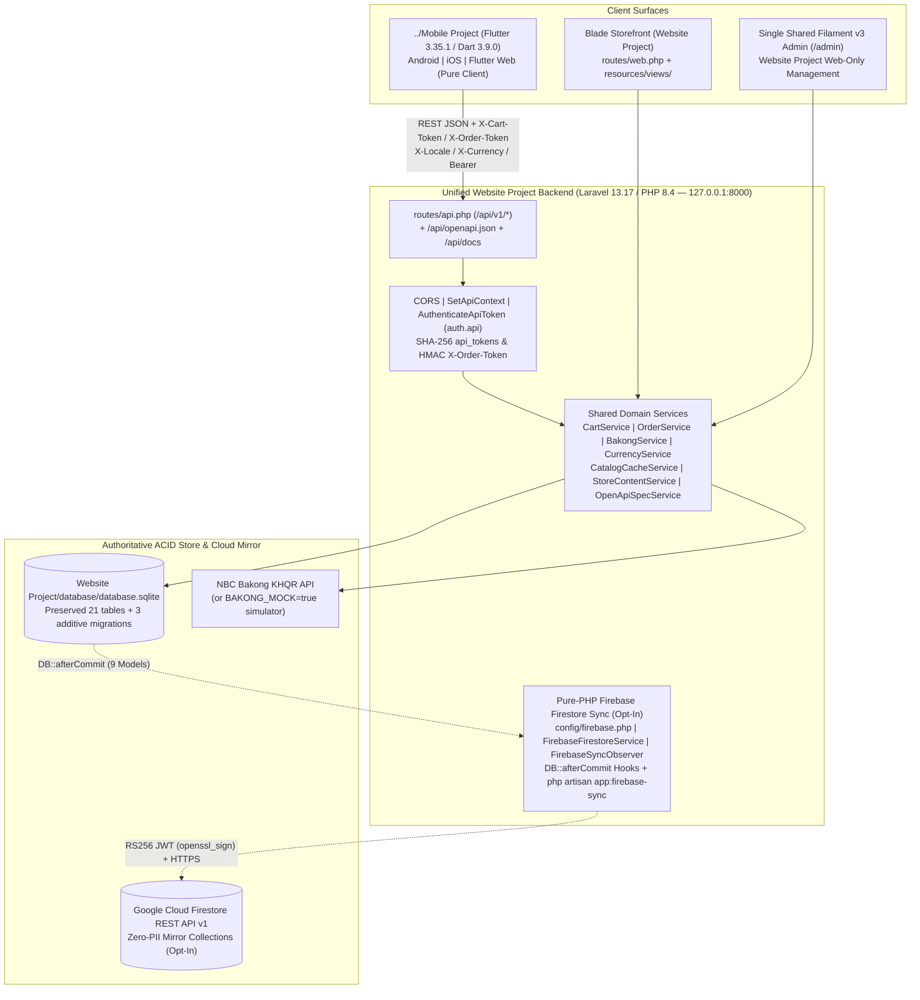

# RESET — Unified Streetwear E-Commerce Platform

> **"Start fresh."** — *Form. Substance. Renewal. Engineered in Phnom Penh.*


A unified, bilingual (**English / Khmer**) minimalist streetwear e-commerce platform combining a **Laravel 13** Blade web storefront (`/`), a single shared **Filament v3 Web Admin** (`/admin`), a stateless **`/api/v1/*` REST API + OpenAPI 3.1.0 / Swagger UI** (`/api/docs`), native **Bakong KHQR** payment processing, pure-PHP **Firebase Cloud Firestore** sync, and a pure **Flutter** cross-platform mobile/web client in `../Mobile Project/`.

> **Architecture & Decision Records:** See [`docs/MEMORY.md`](docs/MEMORY.md), [`docs/ARCHITECTURE.md`](docs/ARCHITECTURE.md), [`docs/adr/001-flutter-laravel-api-architecture.md`](docs/adr/001-flutter-laravel-api-architecture.md), [`docs/adr/002-unified-backend-and-firebase-sync.md`](docs/adr/002-unified-backend-and-firebase-sync.md), [`contracts/api.ts`](contracts/api.ts), and [`specs/PRD.md`](specs/PRD.md).

---

## Table of Contents

1. [Unified Workspace Architecture](#1-unified-workspace-architecture)
2. [Brand Identity & Domain Conventions](#2-brand-identity--domain-conventions)
3. [Quick Start (Backend + Flutter Client)](#3-quick-start-backend--flutter-client)
4. [Interactive API (`/api/docs`), OpenAPI & `api.http`](#4-interactive-api-apidocs-openapi--apihttp)
5. [Safe Sandbox Seeding (`app:seed-scenario`)](#5-safe-sandbox-seeding-appseed-scenario)
6. [Firebase Cloud Firestore Sync Setup](#6-firebase-cloud-firestore-sync-setup)
7. [Environment Variables Reference](#7-environment-variables-reference)
8. [Bakong KHQR Flow, Scheduler & Filament Admin](#8-bakong-khqr-flow-scheduler--filament-admin)
9. [Verified Test & Build Results](#9-verified-test--build-results)
10. [Docker Deployment & Repository Status](#10-docker-deployment--repository-status)

---

## 1. Unified Workspace Architecture

RESET Store follows an adapted **Contract-First & OpenAPI Golden Path Blueprint** across two cleanly separated sibling workspace folders:

| Workspace | Stack & Version | Responsibilities |
| :--- | :--- | :--- |
| **`Website Project/`** *(this directory)* | **Laravel `^13.17`**, **PHP `8.4`** (`^8.3`), **Filament `^3.2`**, **Tailwind CSS + Alpine.js + Vite**, **SQLite** | Single authoritative backend hosting: Blade Web Storefront (`/`), **ONE shared Filament v3 Web Admin (`/admin`)**, stateless `/api/v1/*` REST API, OpenAPI spec (`/api/openapi.json`), Swagger UI (`/api/docs`), authoritative `database/database.sqlite`, and pure-PHP **Firebase Cloud Firestore** sync. |
| **`../Mobile Project/`** | **Flutter `3.35.1`**, **Dart `3.9.0`** | Pure Flutter client (`lib/`, `pubspec.yaml`, `test/`, `android/`, `ios/`, `web/`, `start-flutter-app.bat`) with **zero** Laravel/Filament/SQLite files. Connects directly to `Website Project` (`http://127.0.0.1:8000` on Web/iOS/Desktop and `http://10.0.2.2:8000` on Android Emulator). |



### Preserved Authoritative Database (`database/database.sqlite`)
`Website Project/database/database.sqlite` is the single relational source of truth and preserves the complete baseline dataset:
- **4 categories**, **24 products**, **168 variants**, **48 images**, **5 users**, **3 discounts**, **11 settings**, **24 reviews**, **1 address**, **1 wishlist**
- Enhanced strictly with **3 non-destructive additive migrations**:
  1. `create_api_tokens_table` (SHA-256 `token_hash` bearer tokens, 30-day expiry)
  2. `add_api_performance_indexes` (indexes on `carts`, `products`, `product_variants`, `reviews`, `orders`, `payments`, `wishlists`)
  3. `add_perf_covering_indexes` (covering indexes on `product_images`, `order_items`, `categories`, `products`, `product_variants`)

---

## 2. Brand Identity & Domain Conventions

- **Brand Name & Tagline:** **RESET** — *"Start fresh."* (*Form. Substance. Renewal.*)
- **Color Tokens:**
  - **Onyx Black** (`#111111`) / **Dark Mode Background** (`#0D0D0D`)
  - **Bone White** (`#F5F4F0`) / **Off-White** (`#FAF9F5`)
  - **Terracotta / Safety Orange** (`#E65100`) / **KHQR Red** (`#E21A1A`)
- **Typography:** **Space Grotesk** (Latin display), **Kantumruy Pro** & **Noto Sans Khmer** (Khmer script), **JetBrains Mono** / **Roboto Mono** (tabular prices & SKUs).
- **Bilingual & Dual Currency:** English (`en`) & Khmer (`km`) with Cambodian Riel (`KHR ៛`) and US Dollar (`USD $`) conversion.

### Key Domain & Parity Rules
| Rule | Details |
| :--- | :--- |
| **Monetary Base Unit (`*_cents`)** | All integer monetary columns (`base_price_cents`, `compare_at_price_cents`, `price_cents`, `subtotal_cents`, `discount_cents`, `shipping_fee_cents`, `total_cents`, `min_spend_cents`, `free_shipping_threshold`) store **base Cambodian Riel (KHR ៛)** integers (e.g., `200000` = `200,000 ៛`). USD display divides base KHR by live `settings.exchange_rate` (default `4100`). |
| **Shipping Parity** | `standard` delivery is **`0 ៛`** across all 25 Cambodian provinces. `express` delivery is **`12,000 ៛`** strictly when `province === 'Phnom Penh'` (`CartService::EXPRESS_SHIPPING_FEE_KHR`). `/api/v1/checkout` rejects non-Phnom Penh `express` orders with HTTP `422`. |
| **Seeded Promo Codes** | `RESET10` (10% off, min `100,000 ៛`), `FREESHIP` (waives standard shipping, min `0 ៛`), `STARTFRESH` (`60,000 ៛` fixed discount, min `250,000 ៛`). |
| **Product Detail Tabs** | Product detail API responses always return 5 localized `detail_tabs` (`description`, `fabric`, `care`, `fit`, `shipping`). |
| **Zero-New-Composer-Deps** | Uses native PHP `openssl_sign` for Firebase RS256 JWTs and lightweight Laravel HTTP/controllers for OpenAPI & SHA-256 bearer tokens — avoiding `ext-grpc` or Composer conflicts on PHP 8.4. |

---

## 3. Quick Start (Backend + Flutter Client)

### System Requirements
- **PHP `8.4+`** (`^8.3`) with `pdo`, `pdo_sqlite`, `openssl`, `bcmath`, `curl`, `mbstring`, `gd`, `zip`, `intl`
- **Composer `2.8+`** & **Node.js `20+` / `22+`** (with `npm`)
- **Flutter `3.35.1+` / Dart `3.9.0+`** (for running `../Mobile Project/`)

### Step 1: Start the Unified Laravel Backend (`Website Project/`)

```bash
cd "Website Project"

# 1. Install PHP & frontend build dependencies
composer install
npm install --ignore-scripts

# 2. Configure environment (keep existing database/database.sqlite intact!)
cp .env.example .env
php artisan key:generate

# 3. Apply only additive migrations safely (DO NOT run migrate:fresh on live database.sqlite)
php artisan migrate --force

# 4. Build Tailwind/Alpine/Vite assets and start the server
npm run build
php artisan serve --host=127.0.0.1 --port=8000
```

> **Important Database Safety Warning:** `Website Project/database/database.sqlite` already contains your live baseline catalog, users, reviews, and settings. **Never run `php artisan migrate:fresh`** against `database/database.sqlite`. Use `app:seed-scenario` against `database/testing_sandbox.sqlite` for clean/stress testing (see [Section 5](#5-safe-sandbox-seeding-appseed-scenario)).

### Step 2: Launch the Flutter Client (`../Mobile Project/`)

#### Option A — One-Click Windows Launcher
Double-click [`../start-all.bat`](../start-all.bat) (or [`../Mobile Project/start-flutter-app.bat`](../Mobile%20Project/start-flutter-app.bat)). It starts **`../API` (`http://127.0.0.1:4000`, Firebase Gateway API)**, **`Website Project` (`http://127.0.0.1:8000`, Storefront + `/admin`)**, and launches **Mobile Project** in Chrome.

#### Option B — Manual Flutter CLI
In a second terminal (while `Website Project` is running on port `8000`):

```bash
cd "../Mobile Project"
flutter pub get

# Web (Chrome) -> connects to http://127.0.0.1:8000
flutter run -d chrome --dart-define=API_BASE_URL=http://127.0.0.1:8000

# Android Emulator -> automatically resolves http://10.0.2.2:8000
flutter run -d android

# iOS Simulator -> automatically resolves http://127.0.0.1:8000
flutter run -d ios

# Physical Device on local Wi-Fi (bind backend with: php artisan serve --host=0.0.0.0 --port=8000)
flutter run --dart-define=API_BASE_URL=http://<YOUR_PC_LAN_IP>:8000
```

### Local URLs & Demo Credentials

| Surface | URL | Credentials |
| :--- | :--- | :--- |
| **Blade Web Storefront** | `http://127.0.0.1:8000/` | Customer: `customer@reset.store` / `password` |
| **Filament v3 Web Admin** | `http://127.0.0.1:8000/admin` | Admin: `admin@reset.store` / `password` |
| **Swagger UI (Interactive Docs)** | `http://127.0.0.1:8000/api/docs` | — |
| **OpenAPI 3.1.0 Spec** | `http://127.0.0.1:8000/api/openapi.json` | — |
| **Seeded Customer (Alt)** | Storefront / Mobile App | `kongchhunyt@gmail.com` / `password` |

---

## 4. Interactive API (`/api/docs`), OpenAPI & `api.http`

### OpenAPI & Contract Sync
- **Single Source of Truth Contract:** [`contracts/api.ts`](contracts/api.ts)
- **Live Swagger UI:** Visit `http://127.0.0.1:8000/api/docs`
- **Machine-Readable Spec:** `http://127.0.0.1:8000/api/openapi.json`
- **Export Static OpenAPI Files (`openapi.json` & `public/openapi.json`):**
  ```bash
  php artisan app:export-openapi
  ```

### Stateless API Context Headers
The `/api/v1/*` routes (`routes/api.php`) run purely stateless via `SetApiContext` and `AuthenticateApiToken` (`auth.api`) without PHP sessions:
- `Authorization: Bearer <rst_...>` — Customer token issued on `/api/v1/auth/login` or `/api/v1/auth/register` (stored hashed via SHA-256 in `api_tokens.token_hash`).
- `X-Cart-Token: <uuid>` — Guest cart identifier mapped to `carts.session_id` and atomically merged on login/register.
- `X-Order-Token: <hmac-token>` — HMAC-SHA256 signed guest order access token returned at checkout (`OrderAccessTokenService`) for payment polling, QR regeneration, and tax invoice retrieval (`?order_token=` query fallback supported for invoices).
- `X-Locale: en | km` (fallback: `?lang=` or `Accept-Language`)
- `X-Currency: KHR | USD` (fallback: `?currency=`)

### One-Click Testing with `api.http`
Open [`api.http`](api.http) in VS Code (**REST Client** extension) or JetBrains IDEs to execute ready-to-run requests against `http://127.0.0.1:8000` for:
- `GET /api/openapi.json` & `GET /api/docs`
- `GET /api/v1/bootstrap`, `GET /api/v1/home`, `GET /api/v1/products`, `GET /api/v1/search/suggest`, `GET /api/v1/products/{slug}`
- `POST /api/v1/cart/items`, `POST /api/v1/cart/discount` (`RESET10` / `FREESHIP` / `STARTFRESH`)
- `POST /api/v1/checkout`
- `GET /api/v1/payments/{payment}/status`, `POST /api/v1/payments/{payment}/simulate-pay` (requires `BAKONG_MOCK=true`), `GET /api/v1/orders/{orderNumber}/invoice`
- `POST /api/v1/auth/login`, `GET /api/v1/account/profile`, `GET /api/v1/account/orders`
- `GET /api/v1/pages/{slug}`, `POST /api/v1/newsletter`

---

## 5. Safe Sandbox Seeding (`app:seed-scenario`)

`App\Console\Commands\SeedScenarioCommand` implements deterministic **Tri-Scenario Seeding** (`clean`, `demo`, `stress`) with a built-in safety guard: running against live `database/database.sqlite` outside `APP_ENV=testing` is **blocked** unless `--force-destructive` is explicitly passed.

Always pass `--database=database/testing_sandbox.sqlite` (gitignored) or `--database=:memory:`:

```bash
# 1. Clean scenario (0 domain records — empty-state QA)
php artisan app:seed-scenario clean --database=database/testing_sandbox.sqlite

# 2. Demo scenario (standard baseline catalog, 3 discounts, settings, users & reviews)
php artisan app:seed-scenario demo --database=database/testing_sandbox.sqlite

# 3. Stress scenario (500+ capsule products, 1,500+ variants/images, plus 2 adversarial XSS & 200+ char Unicode products)
php artisan app:seed-scenario stress --database=database/testing_sandbox.sqlite
```

To inspect the Flutter client against a sandbox database without touching `database/database.sqlite`, override `DB_DATABASE` temporarily when starting the test server, and delete `database/testing_sandbox.sqlite*` once finished.

---

## 6. Firebase Cloud Firestore Sync Setup

SQLite (`database/database.sqlite`) remains the authoritative ACID primary store for Filament v3 and Bakong KHQR `lockForUpdate()` inventory reservations. When enabled, `FirebaseFirestoreService` mirrors non-PII storefront data to Google Cloud Firestore REST API v1 via `DB::afterCommit` hooks (`FirebaseSyncObserver`) using native PHP `openssl_sign` RS256 JWTs — **zero** Composer or `ext-grpc` packages required.

- **Active Project:** `reset-store-ecommerce` (**Cloud Firestore Standard Edition**, `(default)` database in **`asia-southeast1` / Singapore**)
- **Deployed Security Rules & Indexes:** [`firestore.rules`](firestore.rules) and [`firestore.indexes.json`](firestore.indexes.json) (configured via [`firebase.json`](firebase.json) and [`.firebaserc`](.firebaserc))
  - Public read-only: `categories`, `products` (`is_published == true`), allowlisted `settings`, `reviews` (`is_approved == true`)
  - Client-blocked (`allow read, write: if false`): `discounts`, `orders`, `payments`, all client writes, and catch-all unmatched paths

### Local Setup & Sync Commands
1. **Authenticate with Firebase CLI** and confirm project selection:
   ```bash
   npx -y firebase-tools@latest login
   ```
2. **Generate a Service Account JSON key** in Firebase Console (*Project Settings -> Service accounts -> Generate new private key*) and place it at:
   ```text
   Website Project/storage/app/firebase/service-account.json
   ```
   *(This path and `*firebase-adminsdk*.json` are already excluded in `.gitignore` — never commit credentials.)*
3. **Update `.env`** in `Website Project/`:
   ```ini
   FIREBASE_ENABLED=true
   FIREBASE_PROJECT_ID=reset-store-ecommerce
   FIREBASE_DATABASE_ID=(default)
   FIREBASE_CREDENTIALS=storage/app/firebase/service-account.json
   FIREBASE_COLLECTIONS_PREFIX=
   FIREBASE_SYNC_ON_WRITE=true
   FIREBASE_TIMEOUT=10
   ```
4. **Deploy Security Rules & Indexes (`firestore.rules`):**
   ```bash
   npx -y firebase-tools@latest deploy --only firestore --project reset-store-ecommerce
   ```
5. **Validate and Backfill Existing Records:**
   ```bash
   # Preview payload sizes & verify zero-PII serialization without network calls
   php artisan app:firebase-sync --dry-run

   # Push all supported non-PII collections to Cloud Firestore
   php artisan app:firebase-sync

   # Or sync specific collections only
   php artisan app:firebase-sync --only=categories,products,settings
   ```

### Zero-PII Cloud Mirroring Policy
| SQLite Source | Firestore Document Path | Synced Content | Excluded Sensitive / PII Data |
| :--- | :--- | :--- | :--- |
| `Category` | `{prefix}categories/{id}` | Bilingual name, slug, description, image, sort order | — |
| `Product`, `ProductVariant`, `ProductImage` | `{prefix}products/{id}` | Bilingual catalog metadata, stock counts, embedded images & variants | Deleted/unpublished handling |
| `Discount` | `{prefix}discounts/{id}` | Code, type, value, spend limits, active dates | — |
| `Setting` | `{prefix}settings/{key}` | Public storefront allowlist (`store_name`, `exchange_rate`, `free_shipping_threshold`, `province_shipping_fees`, etc.) | Internal/non-allowlisted keys |
| `Review` | `{prefix}reviews/{id}` | Approved reviews (`is_approved = true`), author display name, rating, title, body | `user_id`, `order_id`, email, phone |
| `Order` | `{prefix}orders/{number}` | Totals, currency, status, shipping method, `province` aggregate only, `items_count`, carrier/tracking, timestamps | `email`, `phone`, `user_id`, street/district/commune, `billing_address`, `customer_notes`, `refund_note` |
| `Payment` | `{prefix}payments/{id}` | `order_id`, `order_number`, `provider`, `currency`, `amount`, `status`, timestamps | `qr_string`, `md5`, `account_id`, `bakong_response`, `manual_paid_note`, `manual_paid_by`, `error_message` |

**Tables Never Synced:** `users`, `api_tokens`, `password_reset_tokens`, `sessions`, `carts`, `cart_items`, `addresses`, `wishlists`, `contact_messages`, `newsletter_subscribers`.

---

## 7. Environment Variables Reference

See [`.env.example`](.env.example) for the complete template:

| Variable | Default / Example | Description |
| :--- | :--- | :--- |
| `APP_NAME`, `APP_ENV`, `APP_KEY`, `APP_URL` | `Laravel`, `local`, `http://localhost:8000` | Core Laravel application config. |
| `DB_CONNECTION` | `sqlite` | Uses `database/database.sqlite` by default (MySQL supported). |
| `SESSION_DRIVER`, `QUEUE_CONNECTION`, `CACHE_STORE` | `database`, `database`, `database` | Database-backed sessions, queues, and serialization-safe cache (`serializable_classes => false`). |
| `BAKONG_MOCK` | `false` (`true` for local mock QR) | Enables local KHQR simulator. Automatically forced `false` when `APP_ENV=production`. |
| `BAKONG_TOKEN`, `BAKONG_ACCOUNT_ID` | `your_bakong_token_here`, `merchant_id@bank` | NBC Bakong Open API bearer token & merchant Bakong ID (never hardcoded). |
| `BAKONG_MERCHANT_NAME`, `BAKONG_MERCHANT_CITY` | `"RESET Store"`, `"Phnom Penh"` | Merchant metadata embedded inside EMVCo KHQR payloads. |
| `BAKONG_CURRENCY`, `BAKONG_ACCOUNT_TYPE` | `USD` (`KHR` supported), `individual` | Charge currency (`USD` or `KHR`) and account type (`individual` / `merchant`). |
| `BAKONG_QR_TTL_SECONDS`, `BAKONG_API_URL` | `300`, `https://api-bakong.nbc.gov.kh/v1` | KHQR expiration window (300s default in `.env.example`, 600s fallback in `config/bakong.php`). |
| `STORE_EXCHANGE_RATE`, `STORE_FREE_SHIPPING_THRESHOLD` | `4100`, `200000` | KHR per 1 USD and free shipping threshold in base KHR (`200,000 ៛`). |
| `CORS_ALLOWED_ORIGINS`, `FRONTEND_URL` | `*`, `http://127.0.0.1:8000` | Cross-origin config in `config/cors.php` allowing Flutter Web & Android Emulator (`10.0.2.2`). |
| `FIREBASE_ENABLED`, `FIREBASE_PROJECT_ID`, `FIREBASE_DATABASE_ID` | `false`, empty, `(default)` | Opt-in Cloud Firestore sync switch and target project/database IDs. |
| `FIREBASE_CREDENTIALS`, `FIREBASE_CREDENTIALS_JSON` | `storage/app/firebase/service-account.json` | File path or inline JSON for Google Service Account RS256 signing. |
| `FIREBASE_COLLECTIONS_PREFIX`, `FIREBASE_SYNC_ON_WRITE`, `FIREBASE_TIMEOUT` | empty, `true`, `10` | Optional collection prefix, `DB::afterCommit` auto-sync toggle, and HTTP timeout (seconds). |
| `TELEGRAM_BOT_TOKEN`, `TELEGRAM_CHAT_ID` | empty | Optional merchant order settlement alerts. |

---

## 8. Bakong KHQR Flow, Scheduler & Filament Admin

### Bakong KHQR Payment Lifecycle
1. Customer submits checkout (`POST /checkout` or `POST /api/v1/checkout`).
2. `OrderService::createOrderFromCart()` acquires `lockForUpdate()` inside `DB::transaction`, validates live stock, reserves inventory (`reserved_quantity`), computes all KHR/USD totals server-side, and generates a dynamic EMVCo KHQR string + MD5 hash via `BakongService`.
3. Storefront / Flutter polls `GET /payments/{payment}/status` or `GET /api/v1/payments/{payment}/status` (`throttle:60,1`).
4. In local development with `BAKONG_MOCK=true`, `POST /api/v1/payments/{payment}/simulate-pay` (or the Blade **Simulate Instant Payment** button) finalizes payment immediately. When `BAKONG_MOCK=false` (or `APP_ENV=production`), `simulate-pay` strictly returns HTTP **`403`**.
5. Upon expiration (`expires_at` passed), `payments:expire-stale` releases `reserved_quantity` back to available stock; customers can trigger `POST /api/v1/orders/{orderNumber}/regenerate-qr` to re-check stock and issue a fresh QR.

### Scheduled Maintenance Commands (`routes/console.php`)
| Command | Schedule | Purpose |
| :--- | :--- | :--- |
| `php artisan payments:check-pending` | Every 10 seconds | Polls NBC Bakong gateway for active pending payments. |
| `php artisan payments:expire-stale` | Every minute | Expires unpaid orders and releases reserved variant stock. |

Run locally via `php artisan schedule:work` (and `php artisan queue:work` if dispatching async mail/jobs).

### Shared Filament v3 Web Admin (`/admin`)
- Manage **Categories**, **Products**, **Variants (SKUs & stock)**, **Product Images**, **Orders** (Mark Paid with audit memo, Check KHQR, Fulfill/Ship with tracking dispatch email, Printable Tax Invoice), **Payments**, **Discounts**, **Reviews**, and **Settings** from one shared admin panel at `http://127.0.0.1:8000/admin`.
- Updates made in `/admin` immediately invalidate `CatalogCacheService` / `Setting` caches for both Blade and `/api/v1/*` clients, and trigger `DB::afterCommit` Firestore syncs when `FIREBASE_ENABLED=true`.

---

## 9. Verified Test & Build Results

All automated checks were executed cleanly after unification and Firebase sync integration:

| Workspace | Command | Verified Result |
| :--- | :--- | :--- |
| **`../API/`** | `npm test` & `npm run typecheck` | **14 passed (`0` TS errors)** — Fastify v5 + `firebase-admin` gateway (`4000`), Swagger `/docs`, Tri-Scenario Seeds (`clean`, `demo`, `stress` 520 products), `0` `npm audit --omit=dev` vulnerabilities. |
| **`Website Project/`** | `php artisan test` | **125 passed (766 assertions)** — covers 97 baseline Blade/Filament/Bakong tests + `/api/v1/*` contract & OpenAPI tests + `DatabaseCacheSerializationTest` + `FirebaseSyncTest` + `FirebaseApiGatewayIntegrationTest` (`FirebaseApiClient` & SQLite fallback). |
| **`Website Project/`** | `php artisan app:firebase-sync` | **Synced 66 docs (`0` failed)** to `reset-store-ecommerce` (`asia-southeast1`): `categories: 4`, `products: 24`, `discounts: 3`, `settings: 11`, `reviews: 24`, `orders: 0`, `payments: 0`. |
| **`Website Project/`** | `vendor/bin/pint` | **Passed** — Laravel Pint formatting clean. |
| **`../Mobile Project/`** | `flutter analyze` | **0 issues** |
| **`../Mobile Project/`** | `flutter test` | **27 passed** (includes `firebase_sync_test.dart` and `firebase_gateway_client_test.dart`) |
| **`../Mobile Project/`** | `flutter build web` | **Clean build** (`build/web/`) |

---

## 10. Docker Deployment & Repository Status

### Docker Compose (`Dockerfile` & `docker-compose.yml`)
- `Dockerfile` uses a multi-stage build (**Node 22 Alpine** for Vite asset compilation + **PHP 8.4 FPM Alpine** with Nginx & Supervisor).
- `docker-compose.yml` defines an `app` container (port `80`) paired with a `mysql:8.0` service (`db`). To run locally with Docker:
  ```bash
  docker compose up -d --build
  docker compose exec app php artisan migrate --force
  ```

### Repository Push Confirmation
- **NO `git push` has been executed.** All unification, Firebase integration, verification tests, and documentation updates remain strictly local pending your review.

---

**RESET Store** — Built with precision, architectural clarity, and uncompromising dedication to Cambodian e-commerce excellence.
