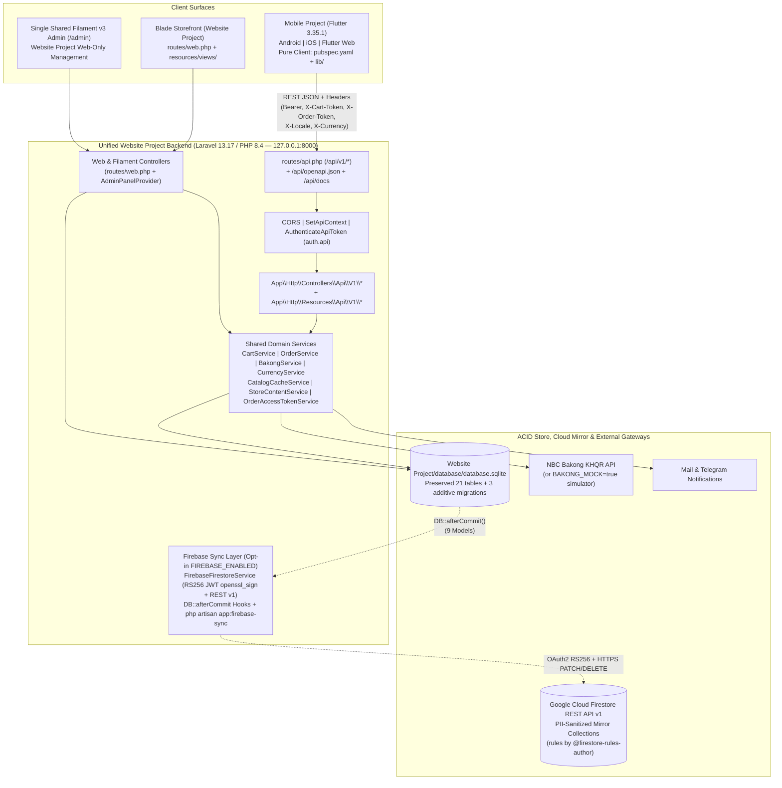

# System Architecture — RESET Store (Unified `Website Project` + Flutter `Mobile Project` + Firebase Firestore Sync)

**Owner:** `@architect`  
**Status:** Approved for Implementation (`Phase 4` Sprint)  
**Single Source of Truth Contract:** [`contracts/api.ts`](../contracts/api.ts)  
**ADR References:** [`docs/adr/001-flutter-laravel-api-architecture.md`](./adr/001-flutter-laravel-api-architecture.md), [`docs/adr/002-unified-backend-and-firebase-sync.md`](./adr/002-unified-backend-and-firebase-sync.md)

---

## 1. High-Level Unified Architecture

`Website Project/` serves as the **single authoritative Laravel 13.17 backend** for all three storefront/management channels over one shared SQLite database (`Website Project/database/database.sqlite`), while `Mobile Project/` operates exclusively as a clean Flutter client (`pubspec.yaml`, `lib/`, `test/`, `android/`, `ios/`, `web/`), and `FirebaseFirestoreService` provides opt-in (`FIREBASE_ENABLED=false` default) Cloud Firestore mirroring after SQLite commits:



---

## 2. Authoritative Database Schema (`Website Project/database/database.sqlite`)

### 2.1 Existing Preserved Tables (21 Tables — Non-Destructive Rule)

All integer monetary columns (`*_cents`, `free_shipping_threshold`, `discounts.value` when `fixed_amount`) store **base Cambodian Riel (KHR ៛)** integer values. Baseline data preserved intact: **4 categories, 24 products, 168 variants, 48 images, 5 users, 3 discounts, 11 settings, 24 reviews, 1 address, 1 wishlist**.

| Table | Key Columns & Types | Relationships & Domain Notes |
| :--- | :--- | :--- |
| **`users`** | `id` PK, `name`, `email` (unique, lowercase), `email_verified_at`, `password` (hashed), `role` (`admin\|staff\|customer`, indexed), `phone`, `remember_token`, timestamps | **5 baseline rows.** Used by Web (`web`/`admin` guards) and API (`api_tokens`). **Never synced to Firestore.** |
| **`password_reset_tokens`** | `email` PK, `token`, `created_at` | Standard Laravel password reset flow (`POST /api/v1/auth/forgot-password`). |
| **`sessions`** | `id` PK, `user_id` (indexed), `ip_address`, `user_agent`, `payload`, `last_activity` (indexed) | Web/Filament sessions ONLY; `/api/v1/*` routes are stateless. |
| **`cache` / `cache_locks`** | `key` PK, `value`, `expiration` | Stores checkout concurrency locks (`Cache::lock`), settings map, catalog cache epoch, and OAuth2 Firestore token. |
| **`jobs` / `job_batches` / `failed_jobs`** | Standard Laravel queue tables | Background mail/queue dispatch. |
| **`categories`** | `id` PK, `name`, `name_km`, `slug` (unique), `description`, `description_km`, `image_url`, `is_active` (bool), `sort_order` (int), timestamps | **4 baseline rows.** Synced to Firestore `categories/{id}`. |
| **`products`** | `id` PK, `category_id` FK, `name`, `name_km`, `slug` (unique), `sku_prefix`, `tagline`, `tagline_km`, `description`, `description_km`, `details` (JSON: `fabric`, `care`, `fit?`, `shipping?`), `base_price_cents` (int KHR), `compare_at_price_cents` (int KHR nullable), `is_featured`, `is_new_arrival`, `is_best_seller`, `is_published`, timestamps | **24 baseline rows.** Synced to Firestore `products/{id}` with embedded `images` & `variants`. |
| **`product_images`** | `id` PK, `product_id` FK, `image_url`, `alt_text`, `is_primary` (bool), `sort_order` (int), timestamps | **48 baseline rows.** Triggers parent `products/{product_id}` Firestore re-sync. |
| **`product_variants`** | `id` PK, `product_id` FK, `sku` (unique), `size`, `color`, `color_code`, `price_cents` (int KHR), `stock_quantity` (int), `reserved_quantity` (int), timestamps | **168 baseline rows.** `available_stock = max(0, stock_quantity - reserved_quantity)`. Triggers parent `products/{product_id}` Firestore re-sync. |
| **`discounts`** | `id` PK, `code` (unique), `type` (`percentage\|fixed_amount\|free_shipping`), `value` (int), `min_spend_cents` (int KHR), `max_uses`, `used_count`, `starts_at`, `expires_at`, `is_active`, timestamps | **3 baseline rows:** `RESET10`, `FREESHIP`, `STARTFRESH`. Synced to Firestore `discounts/{id}`. |
| **`carts`** | `id` (UUID string PK), `user_id` FK nullable, `session_id` string nullable, `discount_id` FK nullable, timestamps | API stores `X-Cart-Token` in `carts.session_id` when `user_id IS NULL`. **Never synced to Firestore.** |
| **`cart_items`** | `id` PK, `cart_id` (UUID FK), `product_variant_id` FK, `quantity` (int), timestamps | Quantities validated `1..20` and `<= available_stock`. |
| **`addresses`** | `id` PK, `user_id` FK, `type` (`shipping\|billing`), `first_name`, `last_name`, `phone`, `province`, `district`, `commune`, `street_address`, `postal_code`, `is_default` (bool), timestamps | **1 baseline row.** Setting `is_default=true` clears `is_default` on user's other addresses. **Never synced to Firestore (PII).** |
| **`orders`** | `id` PK, `number` (unique `RST-YYYY-XXXXX`), `user_id` FK nullable, `email`, `phone`, `shipping_address` (JSON), `billing_address` (JSON), `subtotal_cents`, `discount_cents`, `discount_code`, `shipping_fee_cents`, `shipping_method` (`standard\|express`), `total_cents`, `currency` (`KHR\|USD`), `exchange_rate` (int), `total_charged_currency_amount` (decimal), `status` (enum), `tracking_number`, `shipping_carrier`, `customer_notes`, `refund_amount_cents`, `refund_note`, `paid_at`, `shipped_at`, `delivered_at`, `cancelled_at`, timestamps | Supports guest (`user_id = null`) and member orders. `shipping_fee_cents = 12000` for Phnom Penh `express`. Synced PII-redacted to Firestore `orders/{number}`. |
| **`order_items`** | `id` PK, `order_id` FK, `product_variant_id` FK nullable, `product_name`, `product_name_km`, `variant_label`, `sku`, `price_cents`, `quantity`, `subtotal_cents`, timestamps | Snapshot of purchased line item at checkout time. |
| **`payments`** | `id` PK, `order_id` FK, `provider` (`bakong_khqr`), `md5`, `qr_string`, `account_id`, `amount` (decimal), `currency` (`KHR\|USD`), `status` (`pending\|paid\|expired\|failed`), `expires_at`, `paid_at`, `last_checked_at`, `bakong_response` (JSON), `error_message`, `manual_paid_note`, `manual_paid_by` FK nullable, timestamps | Dynamic EMVCo KHQR transaction log. Synced PII/secret-redacted to Firestore `payments/{id}`. |
| **`reviews`** | `id` PK, `product_id` FK, `user_id` FK, `order_id` FK nullable, `rating` (1..5), `title`, `body`, `is_verified_purchase` (bool), `is_approved` (bool), timestamps | **24 baseline rows.** Upserted by `(product_id, user_id)`. Approved reviews synced without user email/phone to Firestore `reviews/{id}`. |
| **`wishlists`** | `id` PK, `user_id` FK, `product_id` FK, timestamps | **1 baseline row.** Authenticated wishlist toggle. |
| **`settings`** | `id` PK, `key` (unique), `value` (text/JSON), `group`, timestamps | **11 baseline rows.** Public storefront settings allowlist synced to Firestore `settings/{key}`. |
| **`contact_messages`** | `id` PK, `name`, `email`, `subject`, `message`, `is_read` (bool), timestamps | Created via `/contact` and `POST /api/v1/contact`. **Never synced to Firestore (PII).** |
| **`newsletter_subscribers`** | `id` PK, `email` (unique), `is_active` (bool), timestamps | Created via `/newsletter` and `POST /api/v1/newsletter`. **Never synced to Firestore (PII).** |

### 2.2 Additive Migration 1: `api_tokens` Table

```sql
CREATE TABLE api_tokens (
    id INTEGER PRIMARY KEY AUTOINCREMENT,
    user_id INTEGER NOT NULL,
    name VARCHAR(100) NOT NULL DEFAULT 'mobile-app',
    token_hash VARCHAR(64) NOT NULL UNIQUE, -- SHA-256 hex digest of plaintext token
    abilities TEXT NULL,                    -- JSON array, default ["*"]
    last_used_at DATETIME NULL,
    expires_at DATETIME NULL,
    created_at DATETIME NULL,
    updated_at DATETIME NULL,
    FOREIGN KEY (user_id) REFERENCES users(id) ON DELETE CASCADE
);
CREATE INDEX api_tokens_user_id_index ON api_tokens(user_id);
CREATE INDEX api_tokens_expires_at_index ON api_tokens(expires_at);
```

### 2.3 Additive Migration 2: `add_api_performance_indexes`

Non-destructive `Schema::hasIndex`-guarded indexes on existing tables:

| Table | Index Columns | Purpose |
| :--- | :--- | :--- |
| `carts` | `(session_id)`, `(user_id)` | O(1) lookup for `X-Cart-Token` and authenticated member carts. |
| `products` | `(is_published, is_featured)`, `(is_published, is_new_arrival)`, `(is_published, is_best_seller)`, `(category_id, is_published)` | Fast `/api/v1/home` and filtered `/api/v1/products` queries. |
| `product_variants` | `(product_id, size)`, `(product_id, color)` | Accelerates variant resolution and facet queries. |
| `reviews` | `(product_id, is_approved, created_at)` | Fast product review listing and rating aggregates. |
| `orders` | `(user_id, created_at)`, `(status)` | Fast `/api/v1/account/orders` pagination and Filament filters. |
| `payments` | `(order_id, status)`, `(md5)` | Fast polling (`/payments/{id}/status`) and latest payment lookup. |
| `wishlists` | `(user_id, product_id)` | Fast `in_wishlist` check and toggle operation. |

### 2.4 Additive Migration 3: `add_perf_covering_indexes`

Covering indexes validated by `EXPLAIN QUERY PLAN` under 500+ product stress loads:

| Table | Covering Index Columns | Index Name |
| :--- | :--- | :--- |
| `product_images` | `(product_id, sort_order)` | `product_images_product_id_sort_order_index` |
| `order_items` | `(order_id, product_variant_id)` | `order_items_order_id_product_variant_id_index` |
| `categories` | `(is_active, sort_order)` | `categories_is_active_sort_order_index` |
| `products` | `(is_published, base_price_cents)` | `products_is_published_base_price_cents_index` |
| `product_variants` | `(product_id, size, color, color_code)` | `product_variants_product_id_size_color_code_index` |

---

## 3. Firebase Cloud Firestore Sync Architecture

### 3.1 Configuration & Pure-PHP REST Transport

- **Config File (`Website Project/config/firebase.php`):**
  - `enabled` => `(bool) env('FIREBASE_ENABLED', false)` (**MUST default to `false`**)
  - `project_id` => `(string) env('FIREBASE_PROJECT_ID', '')`
  - `database_id` => `(string) env('FIREBASE_DATABASE_ID', '(default)')`
  - `credentials_path` => `(string) env('FIREBASE_CREDENTIALS', storage_path('app/firebase-credentials.json'))`
  - `collection_prefix` => `(string) env('FIREBASE_COLLECTION_PREFIX', '')`
  - `timeout` => `(int) env('FIREBASE_TIMEOUT', 10)`
- **Service (`App\Services\FirebaseFirestoreService`):**
  - **Zero external Composer/gRPC packages:** Reads Service Account JSON (`client_email`, `private_key`, `token_uri`), builds an RS256 JWT assertion signed with PHP's built-in `openssl_sign(..., OPENSSL_ALGO_SHA256)` requesting scope `https://www.googleapis.com/auth/datastore`, and exchanges it for a Google OAuth2 access token cached in Laravel `Cache` (`~50 minutes`).
  - **Document Operations:** Encodes PHP scalars, maps, arrays, integers, floats, booleans, nulls, and ISO-8601 timestamps into Firestore Value JSON (`stringValue`, `integerValue`, `doubleValue`, `booleanValue`, `nullValue`, `timestampValue`, `arrayValue`, `mapValue`) and issues authenticated `PATCH` (upsert) / `DELETE` requests to:
    `https://firestore.googleapis.com/v1/projects/{projectId}/databases/{databaseId}/documents/{collectionPath}/{documentId}`.
  - **Fail-Open Behavior:** If `enabled === false`, credentials are absent, or a transient HTTP error occurs, `FirebaseFirestoreService` logs a warning/error and returns safely without throwing exceptions into checkout, payment verification, or Filament admin actions.

### 3.2 `DB::afterCommit` Model Hooks & Backfill CLI

- **Model Hooks:** Attached in `booted()` across the 9 synced Eloquent models (`Category`, `Product`, `ProductVariant`, `ProductImage`, `Discount`, `Setting`, `Review`, `Order`, `Payment`) and explicitly invoked after bulk/atomic stock updates in `OrderService`:
  - Uses `DB::afterCommit(static fn () => ...)` so Firestore writes ONLY run after SQLite commits (preventing rolled-back `OrderService` stock failures from leaking ghost documents and ensuring SQLite locks are released prior to outbound HTTPS I/O).
- **Artisan Command (`php artisan app:firebase-sync`):**
  - Supports `--only=` (comma-separated: `categories,products,discounts,settings,reviews,orders,payments`) and `--dry-run`.
  - Validates `config('firebase.enabled')` (unless `--dry-run`) and chunks records cleanly from SQLite into `FirebaseFirestoreService`.

### 3.3 Firestore Collection Mapping & Strict PII Exclusion

| Model(s) | Firestore Path | Synced Fields (Typed) | Excluded Sensitive / PII Fields |
| :--- | :--- | :--- | :--- |
| **`Category`** | `{prefix}categories/{id}` | `id`, `name`, `name_km`, `slug`, `description`, `description_km`, `image_url`, `is_active`, `sort_order`, `updated_at` | None (public catalog metadata) |
| **`Product` + `ProductVariant` + `ProductImage`** | `{prefix}products/{id}` | `id`, `category_id`, `category_slug`, `name`, `name_km`, `slug`, `sku_prefix`, `tagline`, `tagline_km`, `description`, `description_km`, `details`, `base_price_cents`, `compare_at_price_cents`, `is_featured`, `is_new_arrival`, `is_best_seller`, `is_published`, `total_stock`, `is_in_stock`, `images[]` (`id`, `image_url`, `alt_text`, `is_primary`, `sort_order`), `variants[]` (`id`, `sku`, `size`, `color`, `color_code`, `price_cents`, `stock_quantity`, `reserved_quantity`, `available_stock`), `updated_at` | Deleted/unpublished products are removed or flagged `is_published: false` per sync policy |
| **`Discount`** | `{prefix}discounts/{id}` | `id`, `code`, `type`, `value`, `min_spend_cents`, `max_uses`, `used_count`, `starts_at`, `expires_at`, `is_active`, `updated_at` | None (restricted by `firestore.rules`) |
| **`Setting`** | `{prefix}settings/{key}` | Public storefront allowlist (`store_name`, `store_tagline`, `store_tagline_km`, `exchange_rate`, `free_shipping_threshold`, `announcement_banner_en`, `announcement_banner_km`, `province_shipping_fees`, `store_email`, `store_phone`, `store_address`) | Any non-allowlisted internal/secret keys |
| **`Review`** | `{prefix}reviews/{id}` | `id`, `product_id`, `author_name` (user display name only), `rating`, `title`, `body`, `is_verified_purchase`, `is_approved`, `created_at`, `updated_at` (deleted from Firestore if `is_approved === false` or deleted) | `user_id`, `order_id`, `user.email`, `user.phone` |
| **`Order`** | `{prefix}orders/{number}` | `id`, `number`, `status`, `currency`, `exchange_rate`, `subtotal_cents`, `discount_cents`, `discount_code`, `shipping_fee_cents`, `shipping_method`, `total_cents`, `total_charged_currency_amount`, `province` (`shipping_address.province` aggregate only), `items_count`, `shipping_carrier`, `tracking_number`, `paid_at`, `shipped_at`, `delivered_at`, `cancelled_at`, `updated_at` | **Strictly Excluded:** `email`, `phone`, `user_id`, `shipping_address.name`/`street_address`/`district`/`commune`, `billing_address`, `customer_notes`, `refund_note` |
| **`Payment`** | `{prefix}payments/{id}` | `id`, `order_id`, `order_number`, `provider`, `currency`, `amount`, `status`, `expires_at`, `paid_at`, `updated_at` | **Strictly Excluded:** `qr_string`, `md5`, `account_id`, `bakong_response`, `manual_paid_note`, `manual_paid_by`, `error_message` |

**Tables Never Synced to Firestore:** `users`, `api_tokens`, `password_reset_tokens`, `sessions`, `carts`, `cart_items`, `addresses`, `wishlists`, `contact_messages`, `newsletter_subscribers`.

> **Security Rules Gate:** Authoring and deploying `firestore.rules` MUST be delegated to `@firestore-rules-author` after the Executive Stakeholder authenticates via `firebase login` and selects a Firebase Project ID.

---

## 4. Stateless Auth, Guest Tokens & Domain Parity Architecture

1. **Bearer Token Lifecycle (`api_tokens`):**
   - Plaintext token (`rst_` + 64 hex chars) returned once on `/api/v1/auth/login` & `/api/v1/auth/register`; `hash('sha256', $plainText)` stored in `api_tokens.token_hash` with 30-day `expires_at`.
   - `SetApiContext` resolves `X-Locale` / `Accept-Language` / `?lang=` (`en|km`), `X-Currency` / `?currency=` (`KHR|USD`), and optional `Authorization: Bearer` (throttling `last_used_at` updates to 5-minute intervals to prevent SQLite write contention).
   - `AuthenticateApiToken` (`auth.api`) enforces HTTP `401 UNAUTHENTICATED` on protected routes without touching web/admin session guards.
2. **Stateless Guest Cart (`X-Cart-Token`) & Atomic Merge:**
   - `CartService::resolveApiCart()` maps `X-Cart-Token` to `carts.session_id` without touching PHP `Session::*`; `login`/`register` invoke `mergeGuestCartByToken()` atomically.
3. **Stateless Guest Order Access (`X-Order-Token`):**
   - `OrderAccessTokenService` issues and verifies (`hash_equals`) Base64URL + HMAC-SHA256 tokens bound to `order_number`, `order_id`, `sha256(email)`, and expiry (`?order_token=` fallback for invoice links).
4. **Domain Parity & Caching:**
   - `CartService::EXPRESS_SHIPPING_FEE_KHR = 12000` exclusively for `Phnom Penh`; `OrderService::createOrderFromCart()` forwards `$data['shipping_method'] ?? 'standard'`.
   - `CurrencyService::current()` inspects `request()->attributes->get('api_currency')` and `X-Currency` before web session/cookie.
   - `Setting::allValues()` uses `Cache::memo()` and auto-invalidates on `saved`/`deleted`.
   - `CatalogCacheService` uses atomic epoch keys invalidated by `Product`, `ProductVariant`, `ProductImage`, `Category`, `Review`, `Setting`, and `OrderService`.
   - `ProductDetailResource` always emits 5 localized `detail_tabs` (`description`, `fabric`, `care`, `fit`, `shipping`).
   - `GET /api/v1/orders/{number}/payment` never regenerates or mutates stock on `GET` when a payment row already exists.

---

## 5. Tri-Scenario Seed Strategy & OpenAPI 3.1

- **Safe Sandbox Seeding (`php artisan app:seed-scenario {clean|demo|stress} [--database=] [--force-destructive]`):**
  - Blocks destructive resets against `Website Project/database/database.sqlite` unless `APP_ENV === 'testing'` or `--force-destructive` is explicitly supplied; uses `:memory:` or `database/testing_sandbox.sqlite` for QA and `@perf`.
- **OpenAPI 3.1 & Swagger UI:**
  - `GET /api/openapi.json` (`OpenApiController@spec` + `OpenApiSpecService`, exported via `php artisan app:export-openapi` to `openapi.json` & `public/openapi.json`).
  - `GET /api/docs` (`OpenApiController@docs` rendering Swagger UI 5.x).

---

## 6. Split Workspace Layout (`Website Project/` vs `Mobile Project/`)

```text
E-Commerce Project/
├── Website Project/                   # SINGLE AUTHORITATIVE BACKEND + WEB + ADMIN
│   ├── app/
│   │   ├── Console/Commands/          # SeedScenarioCommand, ExportOpenApiCommand, FirebaseSyncCommand
│   │   ├── Filament/                  # ONE shared Filament v3 Admin (/admin)
│   │   ├── Http/Controllers/
│   │   │   ├── Api/OpenApiController.php
│   │   │   ├── Api/V1/*               # Stateless REST API controllers
│   │   │   └── *                      # Existing Blade storefront controllers
│   │   ├── Http/Middleware/           # SetLocale, SetApiContext, AuthenticateApiToken
│   │   ├── Http/Resources/Api/V1/*    # Typed JSON resources matching contracts/api.ts
│   │   ├── Models/                    # 21 domain models + ApiToken + DB::afterCommit Firebase hooks
│   │   └── Services/                  # Cart, Order, Bakong, Currency, CatalogCache, StoreContent,
│   │                                  # OrderAccessToken, OpenApiSpec, FirebaseFirestoreService
│   ├── config/
│   │   ├── bakong.php
│   │   ├── cors.php                   # Allows Flutter Web/Emulator origins & custom X-* headers
│   │   └── firebase.php               # FIREBASE_ENABLED=false default + Service Account settings
│   ├── contracts/api.ts               # Single Source of Truth v1 contract
│   ├── database/
│   │   ├── database.sqlite            # Preserved authoritative SQLite database
│   │   └── migrations/                # Existing migrations + 3 additive API/perf migrations
│   ├── docs/                          # MEMORY.md, ARCHITECTURE.md, adr/001 & adr/002, PERFORMANCE.md
│   ├── routes/
│   │   ├── web.php                    # Blade storefront + /admin auth fallback
│   │   └── api.php                    # /api/openapi.json, /api/docs, /api/v1/*
│   ├── specs/PRD.md
│   └── tests/                         # 97 existing web/admin tests + Feature/Api/* + Firebase sync tests
│
└── Mobile Project/                    # PURE FLUTTER CLIENT (NO LARAVEL / NO SQLITE)
    ├── pubspec.yaml                   # Flutter 3.35.1 / Dart 3.9.0
    ├── start-flutter-app.bat          # Boots ../Website Project (:8000) + launches Flutter client
    ├── lib/
    │   ├── main.dart & app.dart
    │   ├── core/                      # app_config.dart (127.0.0.1:8000 / 10.0.2.2:8000), ApiClient, theme, storage
    │   ├── models/                    # Strongly typed Dart DTOs aligned to contracts/api.ts
    │   ├── providers/                 # Riverpod/Provider state (Bootstrap, Auth, Cart, Catalog, Payment, Account)
    │   ├── screens/                   # Home, Shop, Product Detail, Cart, Checkout, KHQR, Invoice, Auth, Account, Pages
    │   ├── widgets/                   # ProductCard, SearchModal, CartDrawer, KhqrCard, CommonStates
    │   └── l10n/app_strings.dart      # Complete EN/KM copy
    ├── test/                          # Flutter unit & widget tests
    ├── android/
    ├── ios/
    └── web/
```
