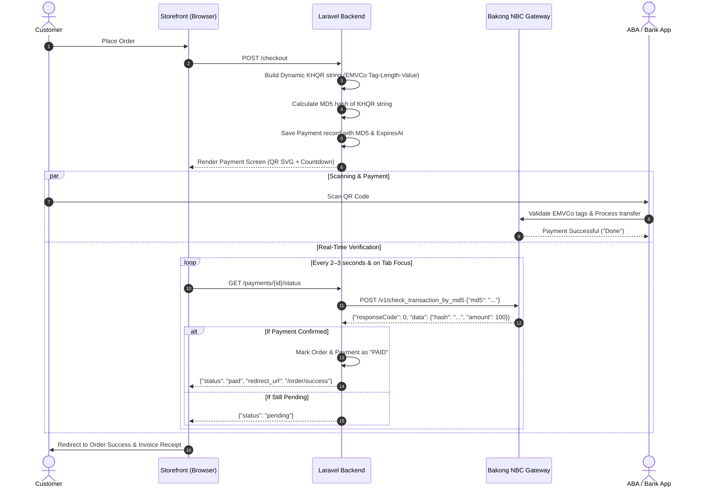

# Complete Guide to Bakong KHQR Payment Integration (Laravel & PHP)

This guide documents the end-to-end process of integrating **Bakong KHQR** dynamic payment QR codes into a Laravel / PHP application, based on official National Bank of Cambodia (NBC) and EMVCo specifications.

---

## 1. Overview & Architecture Flow



---

## 2. Prerequisites & Credentials

To accept payments and verify transactions in production, you need:

1. **Bakong Account ID**:
   - **Individual Wallet**: e.g., `your_name@bkrt` (from Bakong App) or `username@abaa` (from ABA).
   - **Merchant Account**: Assigned by your partner commercial bank (e.g., ABA, Canadia, ACLEDA) when opening a merchant account.
2. **Bakong Developer Token (JWT)**:
   - Generated from the official **[Bakong Developer Portal](https://bakong.nbc.gov.kh/developer/)**.
   - A long JWT string: `eyJhbGciOiJIUzI1NiIsInR5cCI6IkpXVCJ9...`
   - Used in the `Authorization: Bearer <TOKEN>` header to query transaction statuses.

---

## 3. Environment & Configuration Setup

### `.env`
```env
# Bakong KHQR Configuration
BAKONG_TOKEN="eyJhbGciOiJIUzI1NiIsInR5cCI6IkpXVCJ9..."
BAKONG_ACCOUNT_ID="your_wallet@bkrt"
BAKONG_MERCHANT_NAME="My Store Name"
BAKONG_MERCHANT_CITY="Phnom Penh"
BAKONG_CURRENCY="KHR"               # Primary currency: 'KHR' or 'USD'
BAKONG_ACCOUNT_TYPE="individual"    # 'individual' or 'merchant'
BAKONG_QR_TTL_SECONDS=600           # QR validity period (e.g. 600 seconds = 10 mins)
BAKONG_API_URL="https://api-bakong.nbc.gov.kh/v1"
BAKONG_MOCK=false                   # Set true only in local development without internet
```

### `config/bakong.php`
```php
<?php

return [
    'token' => env('BAKONG_TOKEN', ''),
    'account_id' => env('BAKONG_ACCOUNT_ID', ''),
    'merchant_name' => env('BAKONG_MERCHANT_NAME', 'My Store'),
    'merchant_city' => env('BAKONG_MERCHANT_CITY', 'Phnom Penh'),
    'currency' => env('BAKONG_CURRENCY', 'KHR'),
    'account_type' => env('BAKONG_ACCOUNT_TYPE', 'individual'),
    'qr_ttl_seconds' => (int) env('BAKONG_QR_TTL_SECONDS', 600),
    'api_url' => env('BAKONG_API_URL', 'https://api-bakong.nbc.gov.kh/v1'),
    'mock' => (bool) env('BAKONG_MOCK', false) && env('APP_ENV') !== 'production',
];
```

---

## 4. Database Schema: Orders & Payments

Create a dedicated `payments` table linked to your orders table:

```php
Schema::create('payments', function (Blueprint $table) {
    $table->id();
    $table->foreignId('order_id')->constrained()->cascadeOnDelete();
    $table->string('provider')->default('bakong_khqr');
    $table->string('md5')->index(); // 32-character MD5 hash of the raw KHQR string
    $table->text('qr_string');       // The raw EMVCo KHQR string
    $table->string('account_id');    // Receiver Bakong Account ID
    $table->decimal('amount', 14, 2);
    $table->string('currency', 3);  // 'KHR' or 'USD'
    $table->string('status')->default('pending')->index(); // pending, paid, expired, failed
    $table->timestamp('expires_at');
    $table->timestamp('paid_at')->nullable();
    $table->timestamp('last_checked_at')->nullable();
    $table->json('bakong_response')->nullable(); // Raw NBC response with settlement hash
    $table->timestamps();
});
```

---

## 5. EMVCo KHQR Generation (Specification Rules)

Bakong KHQR adheres to the international **EMVCo Merchant-Presented QR Code** standard using the **Tag-Length-Value (TLV)** format.

### TLV Format Rule
Each data element consists of:
1. **Tag**: 2 digits (e.g., `00`)
2. **Length**: 2 digits (e.g., `02`)
3. **Value**: The content of that exact length (e.g., `01`)

Example helper in PHP:
```php
function tlv(string $tag, string $value): string
{
    return sprintf('%02d%02d%s', (int) $tag, strlen($value), $value);
}
```

### Complete Tag Breakdown for Dynamic KHQR

| Tag | Name | Dynamic Value / Rules |
|---|---|---|
| `00` | Payload Format Indicator | Always `01` |
| `01` | Point of Initiation Method | `12` (Dynamic QR with fixed amount and expiry) |
| `29` | Individual Account Info | Used when `account_type = individual`. Contains subtag `00` (Bakong Account ID). |
| `30` | Merchant Account Info | Used when `account_type = merchant`. Contains subtags for Merchant ID, Bank Code. |
| `52` | Merchant Category Code | `5999` (General Retail) |
| `53` | Transaction Currency | `116` for **KHR**, `840` for **USD** (ISO 4217 standard) |
| `54` | Transaction Amount | Formatted amount: **Integer** for KHR (e.g., `100`), **2 decimals** for USD (e.g., `25.50`) |
| `58` | Country Code | `KH` (Cambodia) |
| `59` | Merchant Name | Clean alphanumeric merchant name (e.g., `RESET Store`) |
| `60` | Merchant City | e.g., `Phnom Penh` |
| `62` | Additional Data Template | Subtag `01` (Bill / Order Number). **NO ILLEGAL CHARACTERS (`#`, `&`, etc.)** |
| `99` | Timestamp Template | **CRITICAL**: Must contain Subtag `00` (Creation MS) AND Subtag `01` (Expiration MS) |
| `63` | CRC-16 Checksum | 4 uppercase hex digits computed via EMVCo CCITT polynomial `0x1021` |

---

## 6. Critical Lessons & Pitfalls to Avoid

### ⚠️ Pitfall 1: Tag 99 Expiration Subtag (ABA Mobile Rejection)
- **The Issue**: Some outdated packages only output subtag `00` (Creation timestamp) in Tag 99.
- **The Error**: ABA Mobile and other banking apps reject the QR with `[MAPP-KHQR-INV-FORMAT]` ("Invalid QR code. Please ask receiver to present a new QR code").
- **The Solution**: Tag 99 **MUST** include both:
  - Subtag `00`: 13-digit Unix timestamp in milliseconds when created.
  - Subtag `01`: 13-digit Unix timestamp in milliseconds when expired.

```php
$creationMs = (string) (int) (microtime(true) * 1000);
$expirationMs = (string) (int) ((microtime(true) + $ttlSeconds) * 1000);
$sub00 = tlv('00', $creationMs);
$sub01 = tlv('01', $expirationMs);
$tag99 = tlv('99', $sub00 . $sub01); // Length is 34
```

### ⚠️ Pitfall 2: Individual Accounts (`Tag 29`) vs Merchant Accounts (`Tag 30`)
- An **Individual Account** (`username@bkrt` / `Tag 29`) is a personal wallet.
- **Never include store labels (`03`) or terminal labels (`07`) inside Tag 62 for an Individual account**. Banks like ABA will fail schema validation if terminal labels are passed for an individual wallet.
- Only pass Subtag `01` (Bill / Order Number) in Tag 62 for individual accounts.

### ⚠️ Pitfall 3: Currency & Decimals
- **KHR (`116`)**: Must be an integer with NO decimal places (e.g. `100`, not `100.00`).
- **USD (`840`)**: Must be formatted with exactly 2 decimal places (e.g. `10.50`, not `10.5`).

### ⚠️ Pitfall 4: Carbon 3 Date Difference Bug in Laravel 11
- **The Issue**: In Carbon 3, `now()->diffInSeconds($pastDate)` returns a **negative number** (`-3.0s`).
- **The Impact**: Throttled checks like `if ($secondsSinceLastCheck >= 2)` fail forever, completely disabling status polling on the website!
- **The Solution**: Always use `$pastDate->diffInSeconds(now())` or `abs(now()->diffInSeconds($pastDate))`.

---

## 7. Complete Implementation: `BakongService.php`

```php
<?php

namespace App\Services;

use Exception;
use Illuminate\Support\Facades\Http;
use Illuminate\Support\Facades\Log;

class BakongService
{
    private string $token;
    private string $accountId;
    private string $merchantName;
    private string $merchantCity;
    private int $ttlSeconds;
    private string $apiUrl;

    public function __construct()
    {
        $this->token = config('bakong.token');
        $this->accountId = config('bakong.account_id');
        $this->merchantName = config('bakong.merchant_name', 'Store Name');
        $this->merchantCity = config('bakong.merchant_city', 'Phnom Penh');
        $this->ttlSeconds = (int) config('bakong.qr_ttl_seconds', 600);
        $this->apiUrl = config('bakong.api_url', 'https://api-bakong.nbc.gov.kh/v1');
    }

    /**
     * Build dynamic KHQR string, compute MD5 hash, and return payload.
     */
    public function generateDynamicKhqr(string $orderNumber, float $amount, string $currency = 'KHR'): array
    {
        $isKhr = strtoupper($currency) === 'KHR';
        $currencyCode = $isKhr ? '116' : '840';
        $formattedAmount = $isKhr ? (string) ((int) round($amount)) : number_format($amount, 2, '.', '');

        // 1. Tag 00 & Tag 01: Payload format & Dynamic initiation
        $payload = $this->tlv('00', '01');
        $payload .= $this->tlv('01', '12'); // 12 = Dynamic QR

        // 2. Tag 29: Individual Account Info
        $subTag29 = $this->tlv('00', $this->accountId);
        $payload .= $this->tlv('29', $subTag29);

        // 3. Standard Merchant Tags
        $payload .= $this->tlv('52', '5999');
        $payload .= $this->tlv('53', $currencyCode);
        $payload .= $this->tlv('54', $formattedAmount);
        $payload .= $this->tlv('58', 'KH');
        $payload .= $this->tlv('59', mb_substr($this->merchantName, 0, 25));
        $payload .= $this->tlv('60', mb_substr($this->merchantCity, 0, 15));

        // 4. Tag 62: Bill / Order Reference (Clean alphanumeric, no '#')
        $cleanOrderNumber = preg_replace('/[^A-Za-z0-9\-]/', '', $orderNumber);
        $subTag62 = $this->tlv('01', $cleanOrderNumber);
        $payload .= $this->tlv('62', $subTag62);

        // 5. Tag 99: Timestamps (Creation & Expiration in milliseconds)
        $creationMs = (string) (int) (microtime(true) * 1000);
        $expirationMs = (string) (int) ((microtime(true) + $this->ttlSeconds) * 1000);
        $subTag99 = $this->tlv('00', $creationMs) . $this->tlv('01', $expirationMs);
        $payload .= $this->tlv('99', $subTag99);

        // 6. Tag 63: CRC-16 Checksum
        $crcPrefix = $payload . '6304';
        $crcValue = $this->calculateCrc16($crcPrefix);
        $finalKhqrString = $crcPrefix . $crcValue;

        // 7. MD5 Hash of the raw string for NBC Lookup
        $md5Hash = md5($finalKhqrString);

        return [
            'qr_string' => $finalKhqrString,
            'md5' => $md5Hash,
            'expires_at' => now()->addSeconds($this->ttlSeconds),
        ];
    }

    /**
     * Query NBC Bakong Gateway to check if payment is completed.
     */
    public function checkTransaction(string $md5Hash, float $expectedAmount, string $expectedCurrency): array
    {
        try {
            $response = Http::withToken($this->token)
                ->timeout(10)
                ->post("{$this->apiUrl}/check_transaction_by_md5", [
                    'md5' => $md5Hash,
                ]);

            if (! $response->successful()) {
                return ['paid' => false, 'error' => 'API request failed'];
            }

            $body = $response->json();

            // responseCode 0 means transaction settled successfully
            if (isset($body['responseCode']) && (int) $body['responseCode'] === 0) {
                $tx = $body['data'] ?? [];
                $actualAmount = (float) ($tx['amount'] ?? 0);
                $actualCurrency = strtoupper((string) ($tx['currency'] ?? ''));

                // Verify amount and currency match
                if (abs($actualAmount - $expectedAmount) < 0.01 && $actualCurrency === strtoupper($expectedCurrency)) {
                    return [
                        'paid' => true,
                        'data' => $body['data'],
                    ];
                }
            }

            return ['paid' => false, 'data' => $body];
        } catch (Exception $e) {
            Log::error('Bakong check error: ' . $e->getMessage());
            return ['paid' => false, 'error' => $e->getMessage()];
        }
    }

    private function tlv(string $tag, string $value): string
    {
        return sprintf('%02d%02d%s', (int) $tag, strlen($value), $value);
    }

    /**
     * Compute EMVCo CCITT CRC-16 (Polynomial 0x1021, Initial 0xFFFF)
     */
    private function calculateCrc16(string $data): string
    {
        $crc = 0xFFFF;
        $polynomial = 0x1021;
        $len = strlen($data);

        for ($i = 0; $i < $len; $i++) {
            $crc ^= (ord($data[$i]) << 8);
            for ($j = 0; $j < 8; $j++) {
                if (($crc & 0x8000) !== 0) {
                    $crc = (($crc << 1) ^ $polynomial) & 0xFFFF;
                } else {
                    $crc = ($crc << 1) & 0xFFFF;
                }
            }
        }

        return strtoupper(sprintf('%04X', $crc));
    }
}
```

---

## 8. Polling Controller (`PaymentController.php`)

```php
public function status(Request $request, Payment $payment): JsonResponse
{
    $order = $payment->order;

    // 1. If already paid, return redirect immediately
    if ($payment->status === 'paid' || $order->isPaid()) {
        return response()->json([
            'status' => 'paid',
            'redirect_url' => route('order.success', $order->number),
        ]);
    }

    // 2. Check if expired
    if ($payment->expires_at->isPast()) {
        $payment->update(['status' => 'expired']);
        return response()->json(['status' => 'expired']);
    }

    // 3. Server-side throttled check (every 2 seconds)
    // IMPORTANT: In Carbon 3, use $payment->last_checked_at->diffInSeconds(now())
    $secondsSinceCheck = $payment->last_checked_at
        ? $payment->last_checked_at->diffInSeconds(now())
        : 99;

    if ($secondsSinceCheck >= 2) {
        $payment->update(['last_checked_at' => now()]);
        
        $result = $this->bakongService->checkTransaction(
            $payment->md5,
            (float) $payment->amount,
            $payment->currency
        );

        if ($result['paid']) {
            $payment->update([
                'status' => 'paid',
                'paid_at' => now(),
                'bakong_response' => $result['data'],
            ]);
            
            $order->update([
                'status' => 'paid',
                'paid_at' => now(),
            ]);

            return response()->json([
                'status' => 'paid',
                'redirect_url' => route('order.success', $order->number),
            ]);
        }
    }

    return response()->json([
        'status' => 'pending',
        'seconds_remaining' => max(0, now()->diffInSeconds($payment->expires_at, false)),
    ]);
}
```

---

## 9. Frontend Dynamic QR & Polling (Alpine.js)

```javascript
Alpine.data('khqrPayment', (config) => ({
    secondsRemaining: config.initialSeconds || 300,
    isPaid: false,
    isExpired: false,
    pollingInterval: null,

    init() {
        this.startCountdown();
        this.startPolling();

        // Check immediately when user returns to browser tab from bank app
        document.addEventListener('visibilitychange', () => {
            if (!document.hidden && !this.isPaid && !this.isExpired) {
                this.checkStatus();
            }
        });
        window.addEventListener('focus', () => {
            if (!this.isPaid && !this.isExpired) {
                this.checkStatus();
            }
        });
    },

    async checkStatus() {
        if (this.isPaid || this.isExpired) return;

        try {
            const res = await fetch(config.statusUrl, {
                headers: { 'Accept': 'application/json' }
            });
            const data = await res.json();

            if (data.status === 'paid' && data.redirect_url) {
                this.isPaid = true;
                clearInterval(this.pollingInterval);
                window.location.href = data.redirect_url;
            } else if (data.status === 'expired') {
                this.isExpired = true;
                clearInterval(this.pollingInterval);
            }
        } catch (e) {
            // Silently retry on next tick
        }
    },

    startPolling() {
        // Poll every 3 seconds
        this.pollingInterval = setInterval(() => this.checkStatus(), 3000);
    }
}));
```

---

## 10. QR Rendering & Banking App Deeplink

To render the SVG in Blade:
```bash
composer require simplesoftwareio/simple-qrcode
```

In your controller or view:
```php
$qrSvg = QrCode::format('svg')
    ->size(280)
    ->errorCorrection('M')
    ->margin(2)
    ->generate($payment->qr_string);

// Mobile Banking Deeplink
$deeplinkUrl = 'bakong://qr?data=' . urlencode($payment->qr_string);
```

In Blade:
```blade
<div class="w-64 h-64 mx-auto">
    {!! $qrSvg !!}
</div>

<a href="{{ $deeplinkUrl }}" class="btn">
    Open in Banking App
</a>
```

---

## 11. Quick Testing Checklist

1. [ ] **Valid Token**: Check `BAKONG_TOKEN` in `.env` is active and not expired.
2. [ ] **Correct Account ID**: `your_name@bkrt` for Individual, or bank-assigned ID for Merchant.
3. [ ] **Currency Matching**: If charging in KHR, ensure amount in QR is an integer with NO decimals.
4. [ ] **Tag 99 Formatted**: Contains both creation timestamp (`00`) and expiration timestamp (`01`).
5. [ ] **Carbon 3 Safe**: Throttling uses `$lastChecked->diffInSeconds(now())` to prevent negative diff values.
6. [ ] **Tab Focus Trigger**: Page re-checks status immediately when user switches back from mobile banking app.
