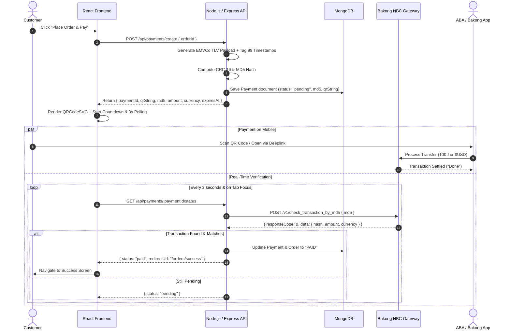

# Complete Guide to Bakong KHQR Integration (React, Node.js & MongoDB)

This guide documents how to build a production-ready **Bakong KHQR** payment integration using the **MERN** stack (**MongoDB, Express.js, React, Node.js**).

---

## 1. System Architecture



---

## 2. Project Setup & Dependencies

### Backend Dependencies (`package.json`)
```bash
npm install express mongoose dotenv cors crypto axios
```

### Frontend Dependencies (`package.json`)
```bash
npm install qrcode.react lucide-react axios
```

---

## 3. Backend: Environment Variables (`.env`)

```env
PORT=5000
MONGODB_URI="mongodb://localhost:27017/my_store"
FRONTEND_URL="http://localhost:3000"

# Bakong Developer Credentials
BAKONG_TOKEN="eyJhbGciOiJIUzI1NiIsInR5cCI6IkpXVCJ9..." # Your JWT token from developer portal
BAKONG_ACCOUNT_ID="your_wallet@bkrt"                   # e.g. name@bkrt (Individual) or Merchant ID
BAKONG_MERCHANT_NAME="RESET Store"
BAKONG_MERCHANT_CITY="Phnom Penh"
BAKONG_CURRENCY="KHR"                                  # 'KHR' or 'USD'
BAKONG_QR_TTL_SECONDS=600                              # 600s = 10 minutes
BAKONG_API_URL="https://api-bakong.nbc.gov.kh/v1"
```

---

## 4. Backend: MongoDB Schemas (`models/`)

### `models/Order.js`
```javascript
const mongoose = require('mongoose');

const orderSchema = new mongoose.Schema({
  orderNumber: { type: String, required: true, unique: true, index: true },
  customerEmail: { type: String, required: true },
  items: [{
    productId: String,
    title: String,
    quantity: Number,
    price: Number
  }],
  totalAmount: { type: Number, required: true },
  currency: { type: String, enum: ['KHR', 'USD'], default: 'KHR' },
  status: {
    type: String,
    enum: ['pending_payment', 'paid', 'processing', 'shipped', 'cancelled'],
    default: 'pending_payment'
  },
  paidAt: { type: Date, default: null }
}, { timestamps: true });

module.exports = mongoose.model('Order', orderSchema);
```

### `models/Payment.js`
```javascript
const mongoose = require('mongoose');

const paymentSchema = new mongoose.Schema({
  orderId: { type: mongoose.Schema.Types.ObjectId, ref: 'Order', required: true },
  orderNumber: { type: String, required: true },
  provider: { type: String, default: 'bakong_khqr' },
  md5: { type: String, required: true, index: true },
  qrString: { type: String, required: true },
  accountId: { type: String, required: true },
  amount: { type: Number, required: true },
  currency: { type: String, enum: ['KHR', 'USD'], required: true },
  status: {
    type: String,
    enum: ['pending', 'paid', 'expired', 'failed'],
    default: 'pending',
    index: true
  },
  expiresAt: { type: Date, required: true },
  paidAt: { type: Date, default: null },
  lastCheckedAt: { type: Date, default: null },
  bakongResponse: { type: Object, default: null }
}, { timestamps: true });

// Check if expired virtual helper
paymentSchema.methods.isExpired = function () {
  return new Date() > this.expiresAt;
};

module.exports = mongoose.model('Payment', paymentSchema);
```

---

## 5. Backend: Bakong Service (`services/bakongService.js`)

This service handles:
1. **EMVCo TLV String Generation** (Tag-Length-Value format).
2. **CRC-16 Calculation** (EMVCo CCITT polynomial `0x1021`).
3. **MD5 Hashing** for the NBC transaction lookup.
4. **Transaction Status Verification** via official NBC API.

```javascript
const crypto = require('crypto');
const axios = require('axios');

class BakongService {
  constructor() {
    this.token = process.env.BAKONG_TOKEN;
    this.accountId = process.env.BAKONG_ACCOUNT_ID;
    this.merchantName = process.env.BAKONG_MERCHANT_NAME || 'RESET Store';
    this.merchantCity = process.env.BAKONG_MERCHANT_CITY || 'Phnom Penh';
    this.ttlSeconds = parseInt(process.env.BAKONG_QR_TTL_SECONDS || '600', 10);
    this.apiUrl = process.env.BAKONG_API_URL || 'https://api-bakong.nbc.gov.kh/v1';
  }

  // Helper to format EMVCo Tag-Length-Value
  tlv(tag, value) {
    const valStr = String(value);
    const tagStr = String(tag).padStart(2, '0');
    const lenStr = String(Buffer.byteLength(valStr, 'utf8')).padStart(2, '0');
    return `${tagStr}${lenStr}${valStr}`;
  }

  // Compute EMVCo CCITT CRC-16 (Polynomial 0x1021, Initial 0xFFFF)
  calculateCrc16(data) {
    let crc = 0xffff;
    const polynomial = 0x1021;
    const buffer = Buffer.from(data, 'utf8');

    for (let i = 0; i < buffer.length; i++) {
      crc ^= (buffer[i] << 8);
      for (let j = 0; j < 8; j++) {
        if ((crc & 0x8000) !== 0) {
          crc = ((crc << 1) ^ polynomial) & 0xffff;
        } else {
          crc = (crc << 1) & 0xffff;
        }
      }
    }

    return crc.toString(16).toUpperCase().padStart(4, '0');
  }

  /**
   * Build dynamic KHQR string adhering to NBC & EMVCo specifications.
   */
  generateDynamicKhqr(orderNumber, amount, currency = 'KHR') {
    const isKhr = currency.toUpperCase() === 'KHR';
    const currencyCode = isKhr ? '116' : '840';
    // KHR must be integer without decimals. USD must have 2 decimal places.
    const formattedAmount = isKhr ? String(Math.round(amount)) : Number(amount).toFixed(2);

    let payload = '';
    // Tag 00: Payload Format (01) & Tag 01: Dynamic Point of Initiation (12)
    payload += this.tlv('00', '01');
    payload += this.tlv('01', '12');

    // Tag 29: Individual Account Info (contains subtag 00)
    const sub29 = this.tlv('00', this.accountId);
    payload += this.tlv('29', sub29);

    // Standard Tags
    payload += this.tlv('52', '5999'); // Retail Category
    payload += this.tlv('53', currencyCode);
    payload += this.tlv('54', formattedAmount);
    payload += this.tlv('58', 'KH');
    payload += this.tlv('59', this.merchantName.substring(0, 25));
    payload += this.tlv('60', this.merchantCity.substring(0, 15));

    // Tag 62: Additional Data (Bill Number / Order Number). NO '#' or illegal characters!
    const cleanBillNo = orderNumber.replace(/[^A-Za-z0-9\-]/g, '');
    const sub62 = this.tlv('01', cleanBillNo);
    payload += this.tlv('62', sub62);

    // Tag 99: CRITICAL for ABA & Bank Apps: Must have creation (00) & expiration (01) in milliseconds
    const creationMs = Date.now().toString();
    const expirationMs = (Date.now() + (this.ttlSeconds * 1000)).toString();
    const sub99 = this.tlv('00', creationMs) + this.tlv('01', expirationMs);
    payload += this.tlv('99', sub99);

    // Tag 63: CRC-16 Checksum
    const prefixForCrc = payload + '6304';
    const crc = this.calculateCrc16(prefixForCrc);
    const finalKhqrString = prefixForCrc + crc;

    // MD5 Hash for transaction verification
    const md5Hash = crypto.createHash('md5').update(finalKhqrString).digest('hex');

    return {
      qrString: finalKhqrString,
      md5: md5Hash,
      expiresAt: new Date(Date.now() + (this.ttlSeconds * 1000)),
      amount: Number(formattedAmount),
      currency: isKhr ? 'KHR' : 'USD'
    };
  }

  /**
   * Check transaction status with National Bank of Cambodia API
   */
  async checkTransactionByMd5(md5Hash, expectedAmount, expectedCurrency) {
    if (!this.token) {
      throw new Error('Bakong token is missing in .env');
    }

    try {
      const response = await axios.post(
        `${this.apiUrl}/check_transaction_by_md5`,
        { md5: md5Hash },
        {
          headers: {
            'Authorization': `Bearer ${this.token}`,
            'Content-Type': 'application/json'
          },
          timeout: 10000
        }
      );

      const body = response.data;

      // responseCode === 0 indicates transaction is completed successfully
      if (body && body.responseCode === 0) {
        const tx = body.data || {};
        const txAmount = Number(tx.amount || 0);
        const txCurrency = String(tx.currency || '').toUpperCase();

        if (Math.abs(txAmount - expectedAmount) < 0.01 && txCurrency === expectedCurrency.toUpperCase()) {
          return {
            paid: true,
            data: tx
          };
        }
      }

      return {
        paid: false,
        data: body
      };
    } catch (err) {
      return {
        paid: false,
        error: err.response?.data?.responseMessage || err.message
      };
    }
  }
}

module.exports = new BakongService();
```

---

## 6. Backend: Express Routes & Controller

### `routes/paymentRoutes.js`
```javascript
const express = require('express');
const router = express.Router();
const Order = require('../models/Order');
const Payment = require('../models/Payment');
const bakongService = require('../services/bakongService');

// 1. Create / Generate Payment QR
router.post('/create', async (req, res) => {
  try {
    const { orderId } = req.body;
    const order = await Order.findById(orderId);
    if (!order) return res.status(404).json({ error: 'Order not found' });

    if (order.status === 'paid') {
      return res.status(400).json({ error: 'Order is already paid' });
    }

    // Generate Dynamic KHQR
    const qrData = bakongService.generateDynamicKhqr(
      order.orderNumber,
      order.totalAmount,
      order.currency
    );

    // Save Payment Record
    const payment = await Payment.create({
      orderId: order._id,
      orderNumber: order.orderNumber,
      md5: qrData.md5,
      qrString: qrData.qrString,
      accountId: process.env.BAKONG_ACCOUNT_ID,
      amount: qrData.amount,
      currency: qrData.currency,
      expiresAt: qrData.expiresAt,
      status: 'pending'
    });

    res.json({
      paymentId: payment._id,
      orderNumber: order.orderNumber,
      amount: payment.amount,
      currency: payment.currency,
      qrString: payment.qrString,
      expiresAt: payment.expiresAt,
      deeplinkUrl: `bakong://qr?data=${encodeURIComponent(payment.qrString)}`
    });
  } catch (err) {
    res.status(500).json({ error: err.message });
  }
});

// 2. Real-Time Status Polling Endpoint (GET /api/payments/:id/status)
router.get('/:id/status', async (req, res) => {
  try {
    const payment = await Payment.findById(req.params.id);
    if (!payment) return res.status(404).json({ error: 'Payment not found' });

    // If already confirmed, return immediately
    if (payment.status === 'paid') {
      return res.json({
        status: 'paid',
        redirectUrl: `/orders/${payment.orderNumber}/success`
      });
    }

    // Check if expired
    if (payment.isExpired()) {
      payment.status = 'expired';
      await payment.save();
      return res.json({ status: 'expired' });
    }

    // Throttle checks to NBC API (run once every 2 seconds max)
    const now = Date.now();
    const lastChecked = payment.lastCheckedAt ? new Date(payment.lastCheckedAt).getTime() : 0;
    const elapsedSeconds = (now - lastChecked) / 1000;

    if (elapsedSeconds >= 2) {
      payment.lastCheckedAt = new Date();
      await payment.save();

      const checkResult = await bakongService.checkTransactionByMd5(
        payment.md5,
        payment.amount,
        payment.currency
      );

      if (checkResult.paid) {
        // Mark payment as paid
        payment.status = 'paid';
        payment.paidAt = new Date();
        payment.bakongResponse = checkResult.data;
        await payment.save();

        // Mark order as paid
        await Order.findByIdAndUpdate(payment.orderId, {
          status: 'paid',
          paidAt: new Date()
        });

        return res.json({
          status: 'paid',
          redirectUrl: `/orders/${payment.orderNumber}/success`
        });
      }
    }

    // Calculate time remaining in seconds
    const secondsRemaining = Math.max(0, Math.floor((new Date(payment.expiresAt) - Date.now()) / 1000));

    res.json({
      status: payment.status,
      secondsRemaining
    });
  } catch (err) {
    res.status(500).json({ error: err.message });
  }
});

module.exports = router;
```

---

## 7. Frontend: React Payment Component (`BakongPayment.jsx`)

Features:
- Crisp SVG QR code rendered via `qrcode.react`.
- Automatic 3-second polling.
- **Instant tab-switch check (`visibilitychange` / `window.focus`)** so when the customer switches back from ABA Mobile, it confirms immediately.
- 10-minute live countdown timer.
- Direct "Open in Banking App" deeplink (`bakong://qr?data=...`).
- "Download QR Code" action.

```jsx
import React, { useState, useEffect, useRef } from 'react';
import { QRCodeSVG } from 'qrcode.react';
import { Smartphone, Download, CheckCircle2, AlertCircle, Clock } from 'lucide-react';
import axios from 'axios';

export default function BakongPayment({ paymentData, onPaymentSuccess }) {
  const { paymentId, orderNumber, amount, currency, qrString, expiresAt, deeplinkUrl } = paymentData;

  const [secondsRemaining, setSecondsRemaining] = useState(
    Math.max(0, Math.floor((new Date(expiresAt) - Date.now()) / 1000))
  );
  const [isPaid, setIsPaid] = useState(false);
  const [isExpired, setIsExpired] = useState(false);
  const isCheckingRef = useRef(false);

  // 1. Format Countdown (MM:SS)
  const formatTime = (secs) => {
    const mins = Math.floor(secs / 60);
    const remainder = secs % 60;
    return `${String(mins).padStart(2, '0')}:${String(remainder).padStart(2, '0')}`;
  };

  // 2. Core Status Checking Function
  const checkStatus = async () => {
    if (isPaid || isExpired || isCheckingRef.current) return;
    isCheckingRef.current = true;

    try {
      const response = await axios.get(`/api/payments/${paymentId}/status`);
      const data = response.data;

      if (data.status === 'paid') {
        setIsPaid(true);
        if (onPaymentSuccess) {
          onPaymentSuccess(data);
        } else if (data.redirectUrl) {
          window.location.href = data.redirectUrl;
        }
      } else if (data.status === 'expired') {
        setIsExpired(true);
      }
    } catch (err) {
      // Network hiccup - ignore and retry on next tick
    } finally {
      isCheckingRef.current = false;
    }
  };

  // 3. Setup Timer, 3s Polling & Tab-Focus Listeners
  useEffect(() => {
    // 1-second countdown tick
    const countdownInterval = setInterval(() => {
      setSecondsRemaining((prev) => {
        if (prev <= 1) {
          clearInterval(countdownInterval);
          setIsExpired(true);
          return 0;
        }
        return prev - 1;
      });
    }, 1000);

    // 3-second polling interval
    const pollingInterval = setInterval(() => {
      checkStatus();
    }, 3000);

    // Instant check when customer switches back to this tab from ABA Mobile
    const handleVisibilityChange = () => {
      if (!document.hidden) {
        checkStatus();
      }
    };
    const handleFocus = () => {
      checkStatus();
    };

    document.addEventListener('visibilitychange', handleVisibilityChange);
    window.addEventListener('focus', handleFocus);

    return () => {
      clearInterval(countdownInterval);
      clearInterval(pollingInterval);
      document.removeEventListener('visibilitychange', handleVisibilityChange);
      window.removeEventListener('focus', handleFocus);
    };
  }, [isPaid, isExpired]);

  // 4. Download QR Code Image
  const downloadQr = () => {
    const svg = document.getElementById('bakong-qr-svg');
    if (!svg) return;
    const svgData = new XMLSerializer().serializeToString(svg);
    const canvas = document.createElement('canvas');
    const ctx = canvas.getContext('2d');
    const img = new Image();
    img.onload = () => {
      canvas.width = img.width;
      canvas.height = img.height;
      ctx.drawImage(img, 0, 0);
      const pngFile = canvas.toDataURL('image/png');
      const downloadLink = document.createElement('a');
      downloadLink.download = `KHQR-${orderNumber}.png`;
      downloadLink.href = pngFile;
      downloadLink.click();
    };
    img.src = 'data:image/svg+xml;base64,' + btoa(svgData);
  };

  return (
    <div className="max-w-md mx-auto bg-white border border-gray-200 rounded-lg shadow-lg overflow-hidden font-sans">
      {/* KHQR Header Bar */}
      <div className="bg-[#E21A1A] px-6 py-4 flex items-center justify-between text-white">
        <span className="font-bold text-lg tracking-wider">KHQR</span>
        <span className="text-xs uppercase font-medium tracking-wide opacity-90">Bakong Certified</span>
      </div>

      <div className="p-6 text-center">
        {/* Merchant & Order Details */}
        <p className="text-xs text-gray-500 uppercase tracking-wider">Merchant Name</p>
        <h2 className="text-lg font-bold text-gray-900 mt-0.5">{process.env.REACT_APP_MERCHANT_NAME || 'RESET Store'}</h2>
        <p className="text-xs text-gray-500 mt-1">
          Order Number: <span className="font-mono font-semibold text-gray-800">#{orderNumber}</span>
        </p>

        {/* Price Display */}
        <div className="my-4 py-3 bg-gray-50 border border-gray-100 rounded">
          <div className="text-2xl font-black text-gray-900">
            {currency === 'KHR' ? `${Number(amount).toLocaleString()} ៛` : `$${Number(amount).toFixed(2)}`}
            <span className="text-xs font-semibold text-gray-500 ml-1.5 uppercase">{currency}</span>
          </div>
        </div>

        {/* QR Code Container */}
        <div className="relative inline-block p-4 bg-white border-2 border-dashed border-gray-300 rounded-lg">
          <div className={isExpired ? 'opacity-10 blur-sm pointer-events-none' : ''}>
            <QRCodeSVG
              id="bakong-qr-svg"
              value={qrString}
              size={240}
              level="M"
              includeMargin={true}
            />
          </div>

          {/* Expired Overlay */}
          {isExpired && !isPaid && (
            <div className="absolute inset-0 flex flex-col items-center justify-center p-4 bg-white/95 text-center">
              <AlertCircle className="w-10 h-10 text-red-500 mb-2" />
              <p className="text-sm font-bold text-gray-900">QR Code Expired</p>
              <p className="text-xs text-gray-500 mt-1 mb-3">Please refresh or generate a new QR code.</p>
              <button
                onClick={() => window.location.reload()}
                className="px-4 py-2 bg-black text-white text-xs font-bold uppercase rounded hover:bg-gray-800"
              >
                Refresh
              </button>
            </div>
          )}
        </div>

        {/* Status & Countdown */}
        {!isExpired && !isPaid && (
          <div className="mt-4">
            <div className="flex items-center justify-center gap-2 text-xs font-medium text-gray-600">
              <span className="w-2 h-2 rounded-full bg-orange-500 animate-ping" />
              <span>Waiting for payment confirmation...</span>
            </div>
            <div className="mt-1.5 text-xs font-mono font-semibold text-gray-800 flex items-center justify-center gap-1">
              <Clock className="w-3.5 h-3.5 text-orange-500" />
              <span>QR expires in <strong className="text-orange-600">{formatTime(secondsRemaining)}</strong></span>
            </div>
          </div>
        )}

        {/* Action Buttons */}
        <div className="mt-6 space-y-2.5">
          <a
            href={deeplinkUrl}
            className="w-full flex items-center justify-center gap-2 py-3 px-4 bg-black text-white text-xs font-bold uppercase tracking-wider rounded hover:bg-orange-600 transition"
          >
            <Smartphone className="w-4 h-4" />
            Open in Banking App
          </a>

          <button
            onClick={downloadQr}
            className="w-full flex items-center justify-center gap-2 py-2.5 px-4 border border-gray-300 text-gray-700 text-xs font-bold uppercase tracking-wider rounded hover:bg-gray-50 transition"
          >
            <Download className="w-4 h-4" />
            Download QR Code
          </button>
        </div>
      </div>

      {/* Certified Footer */}
      <div className="bg-gray-50 px-6 py-3 border-t border-gray-100 text-center">
        <p className="text-[10px] text-gray-500 uppercase tracking-wider flex items-center justify-center gap-1">
          <CheckCircle2 className="w-3.5 h-3.5 text-green-600" />
          Official Bakong KHQR certified by the National Bank of Cambodia.
        </p>
      </div>
    </div>
  );
}
```

---

## 8. Node.js & React Pitfalls to Watch Out For

1. **Tag 99 Timestamps in JavaScript**:
   - In Node.js, `Date.now()` returns milliseconds as a number (e.g. `1789981149017`).
   - Always convert to a string (`Date.now().toString()`) before calculating length in `tlv('00', ...)`.
   - Length of 13-digit timestamp is always `13`. Tag 99 length is always `34` (`0013...0113...`).
2. **Buffer Length vs String Length**:
   - When calculating length in `tlv()`, use `Buffer.byteLength(valStr, 'utf8')` rather than `.length` to correctly handle Unicode Khmer characters in merchant names.
3. **CORS Configuration**:
   - Remember to enable CORS in Express so your React frontend running on port 3000 can query port 5000:
   ```javascript
   const cors = require('cors');
   app.use(cors({ origin: process.env.FRONTEND_URL, credentials: true }));
   ```
4. **Browser Tab Throttling (`visibilitychange`)**:
   - Modern browsers throttle or freeze background `setInterval` timers when the user switches to their banking app.
   - Adding `document.addEventListener('visibilitychange')` guarantees the payment is verified the very millisecond they switch back to the browser.
